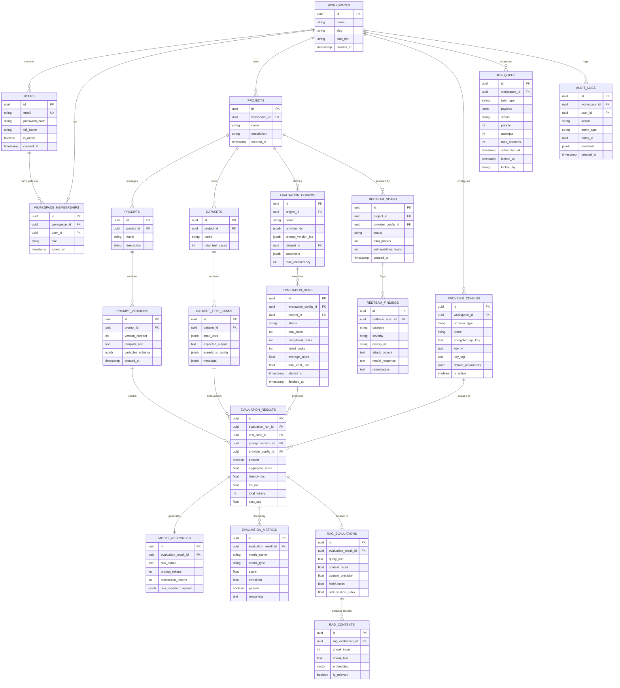

# EvalForge — Database Design & Schema Specification

| Metadata | Value |
|---|---|
| **Document Version** | 1.0.0 |
| **Status** | Approved for Architecture (Phase 0) |
| **RDBMS Engine** | PostgreSQL 16+ with `pgvector` Extension |
| **ORM / Migration Framework** | SQLAlchemy 2.0 (Asyncio) & Alembic |

---

## 1. Schema Design Philosophy

The EvalForge database schema is engineered with the following core architectural requirements:

1. **Normalized 3NF Relational Structure**: Maintain clean relational boundaries to eliminate data redundancy while supporting complex analytical queries for regression testing and benchmarking.
2. **Multi-Tenant Workspace Isolation**: Every top-level entity is partitioned by `workspace_id` to ensure absolute tenant data isolation and prevent cross-customer data leakage.
3. **Encrypted Credential Security**: Provider API keys are never stored in plaintext. They are protected using AES-256-GCM encryption with per-tenant key derivation, separate initialization vectors (IV), and authentication tags.
4. **pgvector Native Embeddings**: Enable high-performance vector similarity search directly within PostgreSQL using HNSW (Hierarchical Navigable Small World) indexes for RAG context relevance and semantic similarity assertions.
5. **Durable Task Queueing**: Implement a dedicated `job_queue` table supporting PostgreSQL `FOR UPDATE SKIP LOCKED` for transactional background job processing without requiring external message brokers in the MVP.
6. **Free-Tier Neon Storage Optimization**: Bound text payload sizes, archive transient jobs, and use JSONB compression to comfortably operate within Neon's 1 GB free-tier limit.

---

## 2. Entity-Relationship (ER) Diagram

The following Mermaid ER diagram illustrates the complete relational model, primary keys, foreign keys, and cardinalities across all EvalForge subsystems.



---

## 3. Detailed Table Specifications & DDL

### 3.1. Tenant & Identity Entities

#### Table: `workspaces`
Encapsulates organization-level multi-tenancy.
```sql
CREATE TABLE workspaces (
    id UUID PRIMARY KEY DEFAULT gen_random_uuid(),
    name VARCHAR(100) NOT NULL,
    slug VARCHAR(100) NOT NULL UNIQUE,
    plan_tier VARCHAR(20) NOT NULL DEFAULT 'FREE', -- 'FREE', 'PRO', 'ENTERPRISE'
    created_at TIMESTAMPTZ NOT NULL DEFAULT NOW(),
    updated_at TIMESTAMPTZ NOT NULL DEFAULT NOW()
);
CREATE INDEX idx_workspaces_slug ON workspaces(slug);
```

#### Table: `users`
Global user credentials and authentication profile.
```sql
CREATE TABLE users (
    id UUID PRIMARY KEY DEFAULT gen_random_uuid(),
    email VARCHAR(255) NOT NULL UNIQUE,
    password_hash VARCHAR(255) NOT NULL, -- Argon2id hash
    full_name VARCHAR(100) NOT NULL,
    is_active BOOLEAN NOT NULL DEFAULT TRUE,
    created_at TIMESTAMPTZ NOT NULL DEFAULT NOW(),
    updated_at TIMESTAMPTZ NOT NULL DEFAULT NOW()
);
CREATE INDEX idx_users_email ON users(email);
```

#### Table: `workspace_memberships`
Role-Based Access Control (RBAC) mapping users to workspaces.
```sql
CREATE TABLE workspace_memberships (
    id UUID PRIMARY KEY DEFAULT gen_random_uuid(),
    workspace_id UUID NOT NULL REFERENCES workspaces(id) ON DELETE CASCADE,
    user_id UUID NOT NULL REFERENCES users(id) ON DELETE CASCADE,
    role VARCHAR(20) NOT NULL DEFAULT 'MEMBER', -- 'OWNER', 'ADMIN', 'MEMBER', 'VIEWER'
    created_at TIMESTAMPTZ NOT NULL DEFAULT NOW(),
    CONSTRAINT uq_workspace_user UNIQUE (workspace_id, user_id)
);
CREATE INDEX idx_workspace_memberships_ws ON workspace_memberships(workspace_id);
CREATE INDEX idx_workspace_memberships_user ON workspace_memberships(user_id);
```

---

### 3.2. Project & Provider Entities

#### Table: `projects`
Logical container for AI applications, evaluations, and datasets.
```sql
CREATE TABLE projects (
    id UUID PRIMARY KEY DEFAULT gen_random_uuid(),
    workspace_id UUID NOT NULL REFERENCES workspaces(id) ON DELETE CASCADE,
    name VARCHAR(100) NOT NULL,
    description TEXT,
    created_at TIMESTAMPTZ NOT NULL DEFAULT NOW(),
    updated_at TIMESTAMPTZ NOT NULL DEFAULT NOW(),
    CONSTRAINT uq_workspace_project_name UNIQUE (workspace_id, name)
);
CREATE INDEX idx_projects_workspace ON projects(workspace_id);
```

#### Table: `provider_configs`
Stores encrypted BYOK provider credentials and model parameters.
```sql
CREATE TABLE provider_configs (
    id UUID PRIMARY KEY DEFAULT gen_random_uuid(),
    workspace_id UUID NOT NULL REFERENCES workspaces(id) ON DELETE CASCADE,
    provider_type VARCHAR(50) NOT NULL, -- 'gemini', 'groq', 'ollama', 'huggingface', 'openai'
    name VARCHAR(100) NOT NULL,
    model_name VARCHAR(100) NOT NULL,
    encrypted_api_key TEXT,            -- Base64 encoded AES-256-GCM ciphertext
    key_iv TEXT,                       -- Base64 encoded 12-byte initialization vector
    key_tag TEXT,                      -- Base64 encoded 16-byte authentication tag
    base_url VARCHAR(255),             -- For local Ollama or custom OpenAI proxy
    default_parameters JSONB NOT NULL DEFAULT '{}'::JSONB, -- temperature, max_tokens, etc.
    is_active BOOLEAN NOT NULL DEFAULT TRUE,
    created_at TIMESTAMPTZ NOT NULL DEFAULT NOW(),
    updated_at TIMESTAMPTZ NOT NULL DEFAULT NOW()
);
CREATE INDEX idx_provider_configs_workspace ON provider_configs(workspace_id);
```

---

### 3.3. Prompts & Dataset Entities

#### Table: `prompts`
Named prompt templates belonging to a project.
```sql
CREATE TABLE prompts (
    id UUID PRIMARY KEY DEFAULT gen_random_uuid(),
    project_id UUID NOT NULL REFERENCES projects(id) ON DELETE CASCADE,
    name VARCHAR(100) NOT NULL,
    description TEXT,
    created_at TIMESTAMPTZ NOT NULL DEFAULT NOW(),
    updated_at TIMESTAMPTZ NOT NULL DEFAULT NOW(),
    CONSTRAINT uq_project_prompt_name UNIQUE (project_id, name)
);
CREATE INDEX idx_prompts_project ON prompts(project_id);
```

#### Table: `prompt_versions`
Immutable version history of prompt templates.
```sql
CREATE TABLE prompt_versions (
    id UUID PRIMARY KEY DEFAULT gen_random_uuid(),
    prompt_id UUID NOT NULL REFERENCES prompts(id) ON DELETE CASCADE,
    version_number INT NOT NULL,
    template_text TEXT NOT NULL,
    variables_schema JSONB NOT NULL DEFAULT '[]'::JSONB, -- List of required template variables
    commit_message VARCHAR(255),
    created_at TIMESTAMPTZ NOT NULL DEFAULT NOW(),
    CONSTRAINT uq_prompt_version UNIQUE (prompt_id, version_number)
);
CREATE INDEX idx_prompt_versions_prompt ON prompt_versions(prompt_id);
```

#### Table: `datasets`
Groups of test cases used across evaluations.
```sql
CREATE TABLE datasets (
    id UUID PRIMARY KEY DEFAULT gen_random_uuid(),
    project_id UUID NOT NULL REFERENCES projects(id) ON DELETE CASCADE,
    name VARCHAR(100) NOT NULL,
    description TEXT,
    created_at TIMESTAMPTZ NOT NULL DEFAULT NOW(),
    updated_at TIMESTAMPTZ NOT NULL DEFAULT NOW()
);
CREATE INDEX idx_datasets_project ON datasets(project_id);
```

#### Table: `dataset_test_cases`
Individual test inputs and assertions.
```sql
CREATE TABLE dataset_test_cases (
    id UUID PRIMARY KEY DEFAULT gen_random_uuid(),
    dataset_id UUID NOT NULL REFERENCES datasets(id) ON DELETE CASCADE,
    input_vars JSONB NOT NULL DEFAULT '{}'::JSONB,        -- {"query": "...", "context": "..."}
    expected_output TEXT,
    assertions_config JSONB NOT NULL DEFAULT '[]'::JSONB, -- Array of assertion definitions
    metadata JSONB NOT NULL DEFAULT '{}'::JSONB,
    created_at TIMESTAMPTZ NOT NULL DEFAULT NOW()
);
CREATE INDEX idx_test_cases_dataset ON dataset_test_cases(dataset_id);
CREATE INDEX idx_test_cases_input_vars_gin ON dataset_test_cases USING GIN (input_vars);
```

---

### 3.4. Evaluation Execution & Results Entities

#### Table: `evaluation_configs`
Declarative evaluation suite configuration.
```sql
CREATE TABLE evaluation_configs (
    id UUID PRIMARY KEY DEFAULT gen_random_uuid(),
    project_id UUID NOT NULL REFERENCES projects(id) ON DELETE CASCADE,
    name VARCHAR(100) NOT NULL,
    provider_ids JSONB NOT NULL,       -- Array of UUIDs of provider_configs
    prompt_version_ids JSONB NOT NULL, -- Array of UUIDs of prompt_versions
    dataset_id UUID NOT NULL REFERENCES datasets(id) ON DELETE RESTRICT,
    default_assertions JSONB NOT NULL DEFAULT '[]'::JSONB,
    max_concurrency INT NOT NULL DEFAULT 3,
    created_at TIMESTAMPTZ NOT NULL DEFAULT NOW()
);
CREATE INDEX idx_eval_configs_project ON evaluation_configs(project_id);
```

#### Table: `evaluation_runs`
Master execution record for an evaluation job.
```sql
CREATE TABLE evaluation_runs (
    id UUID PRIMARY KEY DEFAULT gen_random_uuid(),
    evaluation_config_id UUID REFERENCES evaluation_configs(id) ON DELETE SET NULL,
    project_id UUID NOT NULL REFERENCES projects(id) ON DELETE CASCADE,
    status VARCHAR(30) NOT NULL DEFAULT 'PENDING', -- 'PENDING', 'RUNNING', 'COMPLETED', 'FAILED', 'CANCELLED'
    total_tasks INT NOT NULL DEFAULT 0,
    completed_tasks INT NOT NULL DEFAULT 0,
    failed_tasks INT NOT NULL DEFAULT 0,
    average_score FLOAT,
    total_cost_usd NUMERIC(10, 6) DEFAULT 0.0,
    error_message TEXT,
    started_at TIMESTAMPTZ,
    finished_at TIMESTAMPTZ,
    created_at TIMESTAMPTZ NOT NULL DEFAULT NOW()
);
CREATE INDEX idx_eval_runs_project ON evaluation_runs(project_id);
CREATE INDEX idx_eval_runs_status ON evaluation_runs(status);
```

#### Table: `evaluation_results`
Individual cell output in the Cartesian evaluation matrix.
```sql
CREATE TABLE evaluation_results (
    id UUID PRIMARY KEY DEFAULT gen_random_uuid(),
    evaluation_run_id UUID NOT NULL REFERENCES evaluation_runs(id) ON DELETE CASCADE,
    test_case_id UUID NOT NULL REFERENCES dataset_test_cases(id) ON DELETE CASCADE,
    prompt_version_id UUID NOT NULL REFERENCES prompt_versions(id) ON DELETE CASCADE,
    provider_config_id UUID NOT NULL REFERENCES provider_configs(id) ON DELETE CASCADE,
    passed BOOLEAN NOT NULL DEFAULT FALSE,
    aggregate_score FLOAT NOT NULL DEFAULT 0.0,
    latency_ms FLOAT NOT NULL,
    ttft_ms FLOAT,
    total_tokens INT NOT NULL DEFAULT 0,
    cost_usd NUMERIC(10, 6) DEFAULT 0.0,
    created_at TIMESTAMPTZ NOT NULL DEFAULT NOW()
);
CREATE INDEX idx_eval_results_run ON evaluation_results(evaluation_run_id);
CREATE INDEX idx_eval_results_composite ON evaluation_results(evaluation_run_id, passed);
```

#### Table: `model_responses`
Full raw model completion payload, isolated to optimize evaluation_results table scan speed.
```sql
CREATE TABLE model_responses (
    id UUID PRIMARY KEY DEFAULT gen_random_uuid(),
    evaluation_result_id UUID NOT NULL UNIQUE REFERENCES evaluation_results(id) ON DELETE CASCADE,
    raw_output TEXT NOT NULL,
    prompt_tokens INT NOT NULL DEFAULT 0,
    completion_tokens INT NOT NULL DEFAULT 0,
    cached_tokens INT NOT NULL DEFAULT 0,
    raw_provider_payload JSONB,
    created_at TIMESTAMPTZ NOT NULL DEFAULT NOW()
);
CREATE INDEX idx_model_responses_result ON model_responses(evaluation_result_id);
```

#### Table: `evaluation_metrics`
Discrete assertion scores and feedback per test result.
```sql
CREATE TABLE evaluation_metrics (
    id UUID PRIMARY KEY DEFAULT gen_random_uuid(),
    evaluation_result_id UUID NOT NULL REFERENCES evaluation_results(id) ON DELETE CASCADE,
    metric_name VARCHAR(100) NOT NULL, -- 'exact-match', 'json-schema', 'llm-rubric', etc.
    metric_type VARCHAR(50) NOT NULL,  -- 'deterministic', 'model-graded', 'rag'
    score FLOAT NOT NULL,              -- 0.0 to 1.0
    threshold FLOAT NOT NULL,
    passed BOOLEAN NOT NULL,
    reason TEXT,
    metadata JSONB NOT NULL DEFAULT '{}'::JSONB,
    created_at TIMESTAMPTZ NOT NULL DEFAULT NOW()
);
CREATE INDEX idx_eval_metrics_result ON evaluation_metrics(evaluation_result_id);
```

---

### 3.5. RAG Evaluation Entities

#### Table: `rag_evaluations`
Specialized metrics for Retrieval-Augmented Generation.
```sql
CREATE TABLE rag_evaluations (
    id UUID PRIMARY KEY DEFAULT gen_random_uuid(),
    evaluation_result_id UUID NOT NULL UNIQUE REFERENCES evaluation_results(id) ON DELETE CASCADE,
    query_text TEXT NOT NULL,
    context_recall FLOAT,
    context_precision FLOAT,
    faithfulness FLOAT,
    hallucination_index FLOAT,
    citation_accuracy FLOAT,
    created_at TIMESTAMPTZ NOT NULL DEFAULT NOW()
);
CREATE INDEX idx_rag_evals_result ON rag_evaluations(evaluation_result_id);
```

#### Table: `rag_contexts`
Retrieved text chunks with vector embeddings for relevance scoring.
```sql
-- Ensure extension exists
CREATE EXTENSION IF NOT EXISTS vector;

CREATE TABLE rag_contexts (
    id UUID PRIMARY KEY DEFAULT gen_random_uuid(),
    rag_evaluation_id UUID NOT NULL REFERENCES rag_evaluations(id) ON DELETE CASCADE,
    chunk_index INT NOT NULL,
    chunk_text TEXT NOT NULL,
    embedding VECTOR(1536), -- Standard embedding dimension (supports OpenAI / Gemini text-embedding-004)
    is_relevant BOOLEAN,
    relevance_score FLOAT,
    created_at TIMESTAMPTZ NOT NULL DEFAULT NOW()
);
CREATE INDEX idx_rag_contexts_rag ON rag_contexts(rag_evaluation_id);
CREATE INDEX idx_rag_contexts_embedding_hnsw ON rag_contexts USING hnsw (embedding vector_cosine_ops);
```

---

### 3.6. Red Teaming & Security Entities

#### Table: `redteam_scans`
Master record for automated adversarial scans.
```sql
CREATE TABLE redteam_scans (
    id UUID PRIMARY KEY DEFAULT gen_random_uuid(),
    project_id UUID NOT NULL REFERENCES projects(id) ON DELETE CASCADE,
    provider_config_id UUID NOT NULL REFERENCES provider_configs(id) ON DELETE CASCADE,
    status VARCHAR(30) NOT NULL DEFAULT 'PENDING',
    total_probes INT NOT NULL DEFAULT 0,
    vulnerabilities_found INT NOT NULL DEFAULT 0,
    summary_report JSONB NOT NULL DEFAULT '{}'::JSONB,
    created_at TIMESTAMPTZ NOT NULL DEFAULT NOW(),
    finished_at TIMESTAMPTZ
);
CREATE INDEX idx_redteam_scans_project ON redteam_scans(project_id);
```

#### Table: `redteam_findings`
Discovered vulnerabilities mapped to security taxonomies.
```sql
CREATE TABLE redteam_findings (
    id UUID PRIMARY KEY DEFAULT gen_random_uuid(),
    redteam_scan_id UUID NOT NULL REFERENCES redteam_scans(id) ON DELETE CASCADE,
    category VARCHAR(100) NOT NULL, -- 'prompt-injection', 'jailbreak', 'pii-leakage'
    severity VARCHAR(20) NOT NULL,   -- 'CRITICAL', 'HIGH', 'MEDIUM', 'LOW', 'INFO'
    owasp_id VARCHAR(50),            -- e.g. 'LLM01:2025-Prompt-Injection'
    mitre_atlas_id VARCHAR(50),      -- e.g. 'AML.T0054'
    attack_prompt TEXT NOT NULL,
    model_response TEXT NOT NULL,
    remediation TEXT,
    created_at TIMESTAMPTZ NOT NULL DEFAULT NOW()
);
CREATE INDEX idx_redteam_findings_scan ON redteam_findings(redteam_scan_id);
CREATE INDEX idx_redteam_findings_severity ON redteam_findings(severity);
```

---

### 3.7. Operational Infrastructure Entities

#### Table: `job_queue`
Durable task execution queue supporting PostgreSQL row-level locks.
```sql
CREATE TABLE job_queue (
    id UUID PRIMARY KEY DEFAULT gen_random_uuid(),
    workspace_id UUID NOT NULL REFERENCES workspaces(id) ON DELETE CASCADE,
    task_type VARCHAR(50) NOT NULL,  -- 'EVAL_TEST_TASK', 'REDTEAM_PROBE_TASK'
    payload JSONB NOT NULL,
    status VARCHAR(30) NOT NULL DEFAULT 'PENDING', -- 'PENDING', 'RUNNING', 'FAILED'
    priority INT NOT NULL DEFAULT 0, -- Higher number = higher priority
    attempts INT NOT NULL DEFAULT 0,
    max_attempts INT NOT NULL DEFAULT 3,
    scheduled_at TIMESTAMPTZ NOT NULL DEFAULT NOW(),
    locked_at TIMESTAMPTZ,
    locked_by VARCHAR(100),
    last_error TEXT,
    created_at TIMESTAMPTZ NOT NULL DEFAULT NOW()
);
CREATE INDEX idx_job_queue_worker ON job_queue (status, scheduled_at, priority DESC) 
    WHERE status = 'PENDING';
```

#### Table: `audit_logs`
Immutable compliance and security trail.
```sql
CREATE TABLE audit_logs (
    id UUID PRIMARY KEY DEFAULT gen_random_uuid(),
    workspace_id UUID NOT NULL REFERENCES workspaces(id) ON DELETE CASCADE,
    user_id UUID REFERENCES users(id) ON DELETE SET NULL,
    action VARCHAR(100) NOT NULL,      -- 'PROVIDER_KEY_CREATED', 'DATASET_EXPORTED'
    entity_type VARCHAR(50) NOT NULL,  -- 'provider_config', 'project', 'dataset'
    entity_id UUID NOT NULL,
    ip_address VARCHAR(45),
    metadata JSONB NOT NULL DEFAULT '{}'::JSONB,
    created_at TIMESTAMPTZ NOT NULL DEFAULT NOW()
);
CREATE INDEX idx_audit_logs_ws_time ON audit_logs(workspace_id, created_at DESC);
```

---

## 4. MVP Justification & Neon Free-Tier Storage Sizing

### MVP Sizing Calculations:
- **Average Record Sizes**:
  - `evaluation_results`: $\approx 150 \text{ bytes}$
  - `model_responses`: $\approx 1.5 \text{ KB}$ (average 300 token output)
  - `evaluation_metrics`: $\approx 120 \text{ bytes}$ (3 metrics per test $\approx 360 \text{ bytes}$)
  - Total per evaluated cell: $\approx 2.0 \text{ KB}$
- **Neon 1 GB Storage Capacity**:
  $$1 \text{ GB} = 1,000,000 \text{ KB} \implies \approx 500,000 \text{ individual evaluated test runs}$$
- For a typical user running 100 test cases across 3 models weekly (300 cells/run $\times 4 \text{ weeks} = 1,200 \text{ cells/month}$), **1 GB provides over 30 years of evaluation capacity** without needing data pruning.
