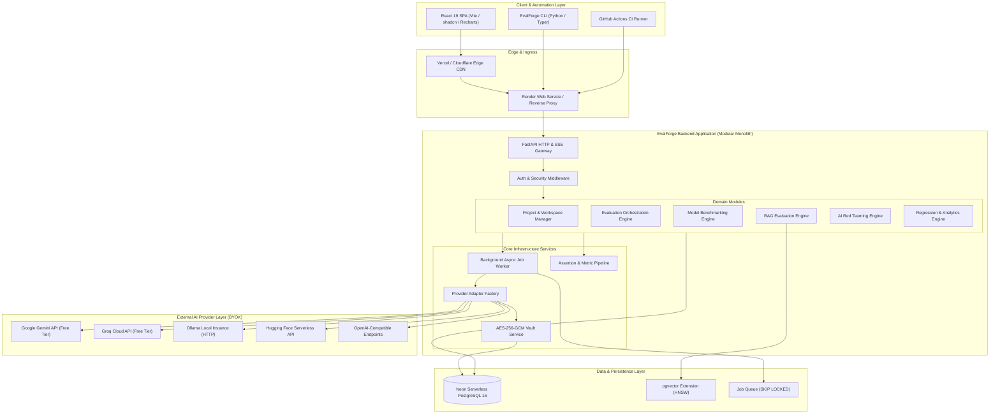
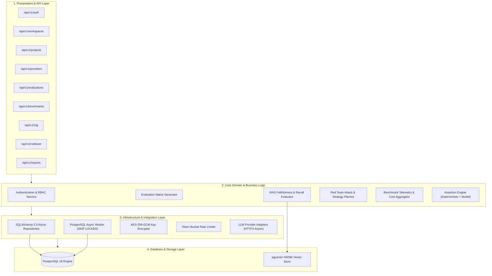
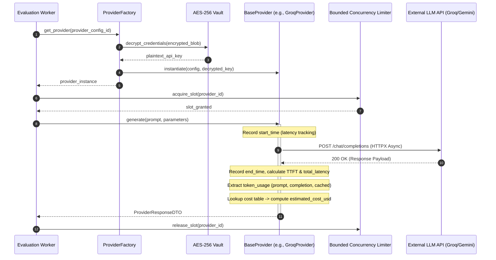
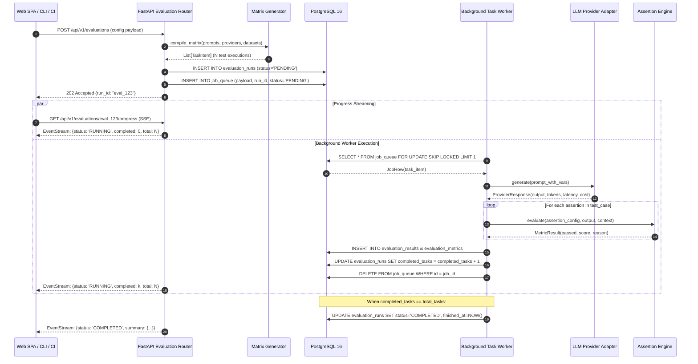
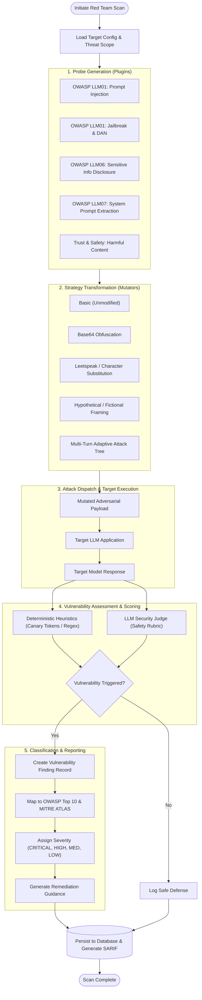
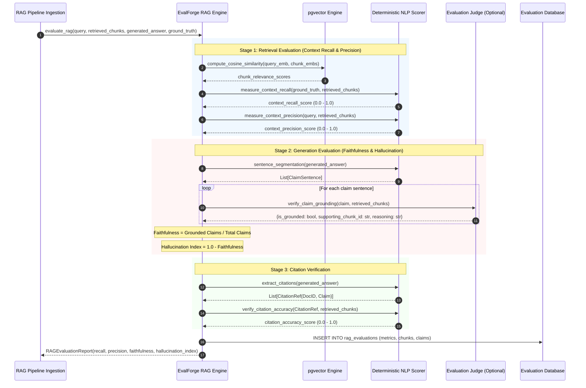
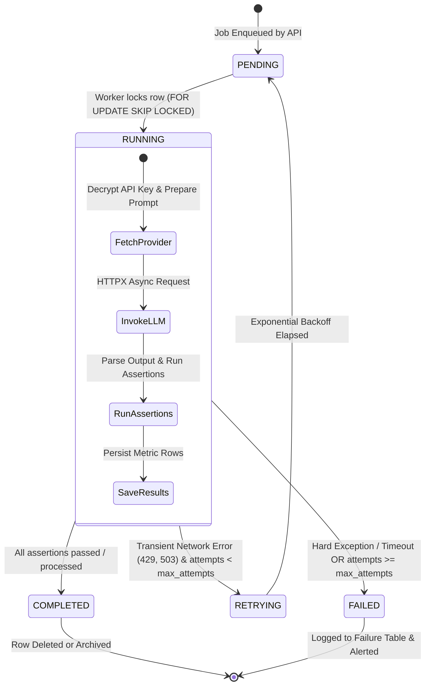
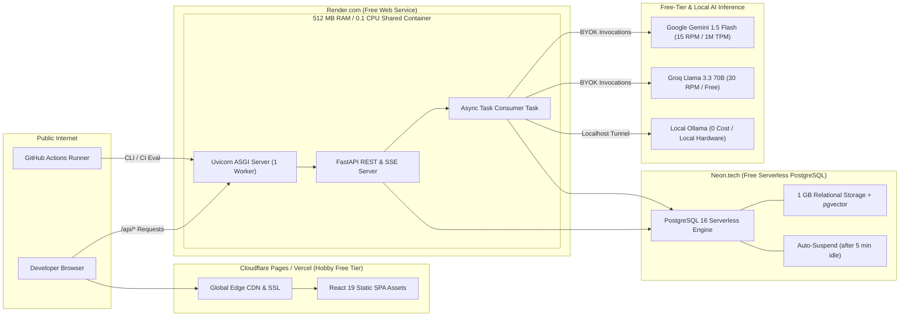

# EvalForge — System Architecture & Technical Specifications

| Metadata | Value |
|---|---|
| **Document Version** | 1.0.0 |
| **Status** | Approved for Architecture (Phase 0) |
| **Architectural Style** | Modular Monolith with Asynchronous Task Worker |
| **Primary Runtime** | Python 3.12+ (FastAPI) & React 19 (Vite) |

---

## 1. Architectural Philosophy & Principles

EvalForge is architected according to five foundational engineering principles:

1. **Modular Monolith First**: Avoid premature distributed systems complexity. Group cohesive domain logic into isolated Python packages with strict internal boundaries.
2. **Deterministic-First Evaluation**: Maximize zero-cost mathematical and syntactic evaluation (regex, JSON Schema, ROUGE, Levenshtein, embeddings) before falling back to expensive LLM judges.
3. **Provider-Agnostic Extensibility**: Isolate all LLM provider interactions behind an abstract adapter interface (`BaseProvider`), making the addition of new providers a single-file implementation.
4. **PostgreSQL-Driven Durability**: Leverage PostgreSQL 16 for relational data, `pgvector` for semantic similarity, and transactional row-locking (`FOR UPDATE SKIP LOCKED`) for background job queueing, eliminating the need for Redis in the MVP.
5. **Zero-Cost Deployment Feasibility**: Ensure every layer of the architecture operates reliably within free-tier resource boundaries (specifically Render's 512 MB RAM and Neon's 1 GB storage limits).

---

## 2. High-Level System Architecture

The following diagram illustrates the complete high-level system context, user interfaces, backend services, persistence layer, and external AI providers.



---

## 3. Backend Module Architecture

The backend adheres to a clean layered architecture within a modular monolith structure. Each module encapsulates its domain entities, service logic, repository queries, and Pydantic validation schemas.



### Module Responsibilities:
- **`evalforge.core`**: Cross-cutting concerns including database session management, base models, configuration settings, exceptions, and security cryptographic primitives.
- **`evalforge.modules.auth`**: User registration, Argon2id password hashing, JWT creation/refresh, and workspace tenant context resolution.
- **`evalforge.modules.projects`**: Workspace and project lifecycle, role assignments, and encrypted provider credential storage.
- **`evalforge.modules.evaluations`**: Evaluation matrix generation, configuration validation, progress tracking, and score aggregation.
- **`evalforge.modules.providers`**: The adapter implementations for Gemini, Groq, Ollama, Hugging Face, and generic OpenAI APIs.
- **`evalforge.modules.assertions`**: Deterministic evaluators (exact, regex, Levenshtein, ROUGE) and LLM-as-a-judge rubrics.
- **`evalforge.modules.rag`**: Chunk processing, context relevance scoring, faithfulness verification, and citation analysis.
- **`evalforge.modules.redteam`**: Adversarial prompt generation, delivery strategy mutation (Base64, jailbreaks), and vulnerability classification.
- **`evalforge.modules.jobs`**: The database-backed async job queue consumer running bounded concurrent workers.

---

## 4. LLM Provider Integration Flow

The Provider Subsystem uses an **Abstract Factory and Adapter Pattern**. All model calls pass through standardized rate-limiting, error handling, key decryption, and telemetry capture.



---

## 5. Evaluation Execution Lifecycle

The evaluation engine takes a declarative test configuration, compiles a Cartesian product of execution tasks, dispatches them through the durable PostgreSQL queue, executes assertions, and streams real-time progress to clients.



---

## 6. AI Red-Teaming Execution Lifecycle

The Red-Teaming subsystem generates adversarial probes using plugins, applies transformation strategies to bypass model guardrails, tests target LLMs, and maps vulnerabilities to standard security frameworks.



---

## 7. RAG Evaluation Workflow

RAG evaluation evaluates both the **Retrieval** stage and the **Generation** stage independently to isolate the root cause of failures.



---

## 8. Background Job Execution Subsystem

To achieve zero-cost hosting without spinning up a separate Redis or RabbitMQ cluster, EvalForge implements a durable **PostgreSQL `FOR UPDATE SKIP LOCKED` worker queue**.



### PostgreSQL Worker Locking Semantics:
```sql
-- Atomically claim the next highest-priority pending task without blocking other workers:
WITH next_task AS (
    SELECT id 
    FROM job_queue 
    WHERE status = 'PENDING' 
      AND scheduled_at <= NOW()
    ORDER BY priority DESC, created_at ASC 
    LIMIT 1
    FOR UPDATE SKIP LOCKED
)
UPDATE job_queue
SET status = 'RUNNING',
    locked_at = NOW(),
    locked_by = :worker_id,
    attempts = attempts + 1
FROM next_task
WHERE job_queue.id = next_task.id
RETURNING job_queue.*;
```

---

## 9. Zero-Cost Cloud Deployment Architecture

The following diagram maps EvalForge's components to verified free-tier cloud platforms, demonstrating zero monthly infrastructure expenditure.



---

## 10. Module Boundaries, Interfaces & Extensibility Contracts

To ensure that new providers, metrics, and red-team attacks can be integrated without breaking existing code, EvalForge mandates strict Python ABC interfaces.

### 10.1. Provider Interface (`BaseProvider`)
```python
from abc import ABC, abstractmethod
from typing import AsyncGenerator
from pydantic import BaseModel

class ProviderResponseDTO(BaseModel):
    output_text: str
    prompt_tokens: int
    completion_tokens: int
    total_tokens: int
    cached_tokens: int = 0
    latency_ms: float
    time_to_first_token_ms: float | None = None
    estimated_cost_usd: float = 0.0
    raw_response: dict | None = None

class BaseProvider(ABC):
    def __init__(self, model_name: str, api_key: str | None = None, options: dict | None = None):
        self.model_name = model_name
        self.api_key = api_key
        self.options = options or {}

    @abstractmethod
    async def generate(self, prompt: str, temperature: float = 0.7, max_tokens: int = 1024) -> ProviderResponseDTO:
        """Execute a non-streaming completion call against the provider."""
        pass

    @abstractmethod
    async def generate_stream(self, prompt: str, **kwargs) -> AsyncGenerator[str, None]:
        """Stream response tokens for interactive debugging."""
        pass
```

### 10.2. Assertion Interface (`BaseAssertion`)
```python
from abc import ABC, abstractmethod
from pydantic import BaseModel

class AssertionResultDTO(BaseModel):
    passed: bool
    score: float  # Normalized between 0.0 and 1.0
    reason: str
    assertion_type: str

class BaseAssertion(ABC):
    @abstractmethod
    async def evaluate(self, actual_output: str, expected_value: any, context: dict | None = None) -> AssertionResultDTO:
        """Evaluate actual LLM response against expected constraints."""
        pass
```
